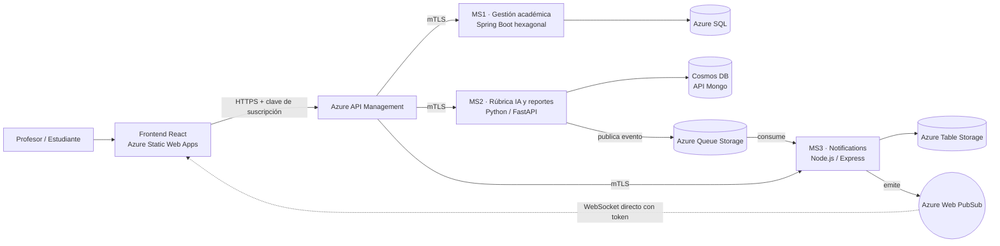

# RevisaTEC

Plataforma de revisión de código entre pares para proyectos grupales de cursos de programación del TEC.

**Aplicación desplegada:** https://green-ocean-067c41510.3.azurestaticapps.net

> **Estado:** Fase II (backend distribuido). El frontend consume tres microservicios reales en Azure App Service, publicados únicamente a través de Azure API Management (APIM). Las notificaciones llegan en tiempo real mediante Azure Web PubSub.

## Descripción

RevisaTEC se conecta al repositorio de GitHub/GitLab de cada equipo y exige que todo cambio pase por revisión de un compañero antes de fusionarse a la rama principal. Calcula un índice de contribución individual objetivo y se lo muestra al profesor en un dashboard.

## Problema que resuelve

Hoy el profesor solo ve el resultado final de un repositorio, sin visibilidad de si hubo control de calidad entre compañeros ni de cuánto aportó cada estudiante. Esto genera notas grupales injustas, deja pasar inconvenientes de último momento (commits de prueba, entregas fuera de plazo) y priva a los estudiantes de practicar el code review.

## Funcionalidades principales

- Inicio de sesión con correo institucional (solo cuentas terminadas en `@estudiantec.cr` o `@itcr`) o con Google (OAuth2), con redirección según el rol.
- Configuración de rúbrica, indicaciones para la IA y frecuencia de análisis por curso.
- Dashboard del profesor con métricas por grupo, próximas entregas e inconvenientes.
- CRUD de grupos y de calendario de hitos, con búsqueda y paginación.
- Detalle de grupo con nota estimada, evidencia de PRs/commits y contribución por estudiante.
- Retroalimentación: propuesta de la IA (reglas deterministas) y versión editable del profesor, con publicación a los estudiantes.
- Detección de inconvenientes (commits de prueba).
- Panel del estudiante: su aporte, retroalimentación publicada y calendario.
- **Notificaciones en tiempo real:** al publicarse una retroalimentación o detectarse un inconveniente, la campana se actualiza sin recargar. El historial se consulta y se marca como leído.
- Fechas en Epoch (milisegundos) desde el backend; el frontend las muestra en la zona horaria del dispositivo.
- Manejo de estados HTTP con mensajes claros (200, 201, 400, 401, 404).
- Tema claro/oscuro persistente y diseño responsive (escritorio, tablet y móvil).

## Arquitectura (Fase II)



- **Punto único de entrada:** todo el tráfico HTTP pasa por APIM; los App Services solo aceptan llamadas con el certificado de cliente de APIM (mTLS).
- **Tiempo real:** el frontend pide un token temporal a `GET /notifications/realtime-token` (por APIM) y abre un WebSocket directo a Azure Web PubSub.
- **Eventos:** MS2 publica `FEEDBACK_PUBLISHED` e `ISSUE_DETECTED` en la cola `notificaciones`; MS3 los guarda en el historial y los emite en vivo.
- **Destinatarios:** las notificaciones se emiten a todos los clientes conectados (profesor y estudiantes). El historial es compartido, sin filtro por usuario.

El diagrama completo y los contratos están en `docs/`.

## Microservicios

| Servicio | Repositorio | Stack | Almacenamiento | Rutas principales |
|---|---|---|---|---|
| MS1 · Gestión académica | `revisatec-ms-core` | Spring Boot (hexagonal) | Azure SQL | `/courses`, `/groups`, `/calendar/events` |
| MS2 · Rúbrica IA y reportes | `revisatec-ms-analysis` | Python / FastAPI | Cosmos DB (API Mongo) | `/courses/{id}/rubric`, `/groups/{id}/analysis`, `/feedback`, `/issues`, `/report` |
| MS3 · Notifications | `revisatec-ms-notifications` | Node.js / Express | Queue + Table Storage | `/notifications`, `/notifications/realtime-token` |

## Stack tecnológico

| Capa | Tecnología |
|---|---|
| Frontend | React 19 + Vite + React Router |
| Backend | Spring Boot, FastAPI y Node.js/Express en Azure App Service |
| Gateway | Azure API Management (Consumption) |
| Almacenamiento | Azure SQL, Cosmos DB (API Mongo), Queue Storage y Table Storage |
| Tiempo real | Azure Web PubSub |
| Hosting del front | Azure Static Web Apps (HTTPS) |
| CI/CD | GitHub Actions (4 repositorios; versionado por tag en el front) |
| Autenticación | Google OAuth2 y correo institucional; clave de suscripción en APIM |
| Pruebas de API | Postman + Newman |

## Convenciones de datos

- Fechas: Epoch en milisegundos (UTC) en todo intercambio con el backend.
- Listas: `{ totalRecords, page, pageSize, items }` (MS3 devuelve la lista en `data`).
- Errores: `{ "error": "mensaje" }` con códigos 200, 201, 400, 401 y 404.

## Seguridad

- El frontend solo conoce la URL de APIM; las URLs `*.azurewebsites.net` no se usan ni se exponen.
- Las llamadas llevan el header `Ocp-Apim-Subscription-Key`. Sin clave, APIM responde 401.
- La clave y las cadenas de conexión **no se guardan en el código**: se definen como variables de entorno (`.env.local` en desarrollo) y como secretos de GitHub Actions en el despliegue. `.env.local` está excluido por Git.

## Instalación y uso

```bash
git clone https://github.com/Crisaraya21/revisatec.git
cd revisatec
npm install
npm run dev
```

Variables de entorno (`.env.local`):

```
VITE_API_BASE_URL=<url base de Azure API Management, incluyendo /revisatec>
VITE_API_SUBSCRIPTION_KEY=<llave de suscripción de APIM>
VITE_GOOGLE_CLIENT_ID=<client ID de OAuth2 de Google>
```

Los valores reales se solicitan al equipo y no se suben al repositorio. En el despliegue se configuran como secretos de GitHub Actions (`VITE_API_BASE_URL`, `VITE_API_SUBSCRIPTION_KEY`, `VITE_GOOGLE_CLIENT_ID`).

## CI/CD y versionado

En cada push a `main`, GitHub Actions ejecuta lint y build y, si pasan, despliega a Azure Static Web Apps. En cada despliegue se crea un tag de Git cuya versión se muestra en el pie de la aplicación. Cada microservicio tiene su propio repositorio y su pipeline de compilación, pruebas y despliegue a Azure App Service.

## Pruebas de API

Cada servicio incluye su colección de Postman (carpeta `postman`) y su contrato `openapi.yaml`. Las colecciones se ejecutan contra APIM con Newman:

```bash
newman run <coleccion>.postman_collection.json -e <entorno>.postman_environment.json
```

Resultados de MS1: 29 requests, 56 assertions, 0 fallos. MS3: 29 pruebas automáticas aprobadas más su colección Postman. El detalle está en `docs/` (reporte consolidado de pruebas).

## Equipo

- **Marlon Fabian Aragón Arce** — UX/UI, frontend, MS3 (notificaciones y tiempo real) y video.
- **Cristopher Daniel Araya Vega** — Infraestructura, APIM, mTLS, CI/CD y MS1.
- **Leiner Josué Aguilar González** — Documentación, pruebas y MS2.

## Capturas de pantalla

| | |
|---|---|
| **Login** (correo institucional o Google) | **Crear grupo** (modal) |
|  |  |
| **Calendario** | **Inconvenientes** |
|  |  |
| **Detalle de grupo** | **Retroalimentación** |
|  |  |
| **Panel del estudiante** | **Mi grupo — modo oscuro** |
|  |  |
| **Calendario — vista móvil** | |
|  | |

## Estructura del repositorio

```
revisatec/
├── .github/workflows/      # CI/CD: lint, build y despliegue a Azure Static Web Apps
├── docs/                   # Arquitectura, contratos OpenAPI, reportes de pruebas y seguridad
├── public/                 # Assets estáticos y staticwebapp.config.json
├── screenshots/            # Capturas usadas en este README
├── src/
│   ├── components/         # Componentes reutilizables
│   ├── context/            # AuthContext, ThemeContext
│   ├── hooks/              # usePaginatedList
│   ├── lib/                # apiClient.js: cliente de la API (APIM)
│   ├── pages/              # Login, Groups, GroupDetail, Rubric, Calendar, Feedback,
│   │                       #   Issues, StudentDashboard, StudentFeedback, StudentGroup
│   ├── App.jsx
│   ├── main.jsx
│   └── theme.css
├── eslint.config.js
├── index.html
├── package.json
├── vite.config.js
└── README.md
```

## Créditos

- [React](https://react.dev/), [Vite](https://vitejs.dev/), [React Router](https://reactrouter.com/)
- [Azure Static Web Apps](https://azure.microsoft.com/products/app-service/static/), [Azure API Management](https://azure.microsoft.com/products/api-management/), [Azure Web PubSub](https://azure.microsoft.com/products/web-pubsub/)
- [GitHub Actions](https://github.com/features/actions), [Postman](https://www.postman.com/), [Figma](https://www.figma.com/), [Draw.io](https://www.drawio.com/)

## Licencia

Proyecto académico — Instituto Tecnológico de Costa Rica (TEC San Carlos), curso IC-6821 Diseño de Software, profesor Marcos Rodríguez, II semestre 2026.